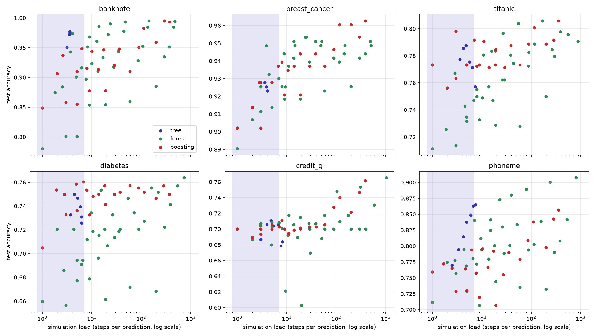
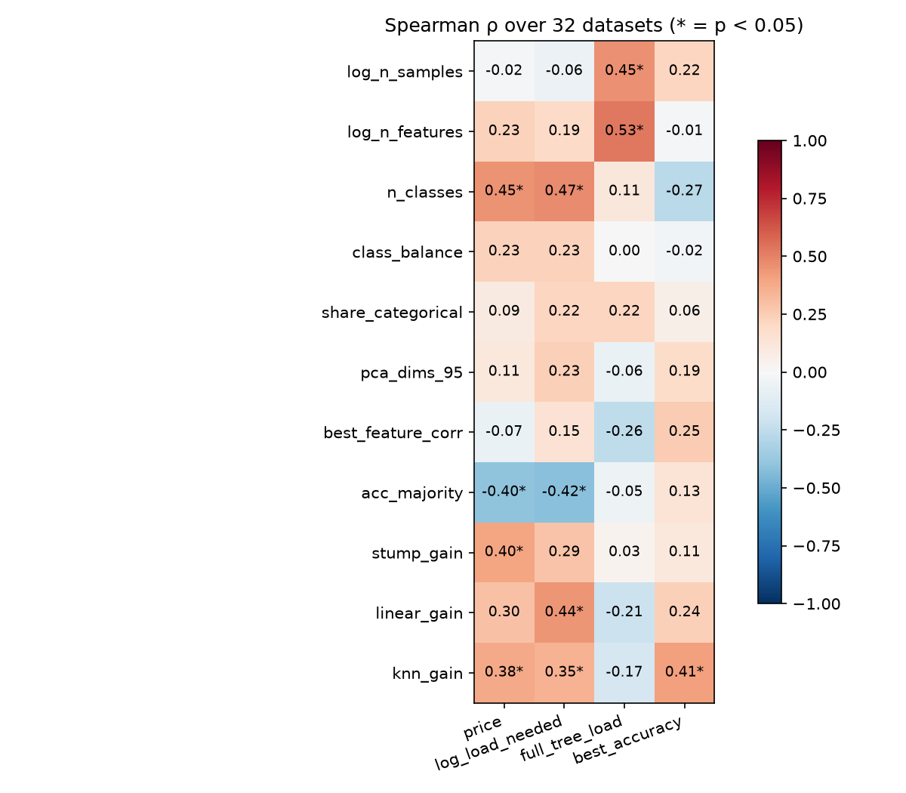

# iML 26/27 – Exercise 1: Simulation Load

**Team Hallucinators:** Kevin Antony, Arsha Fahima Tajdeen, Diya Panikkassery Sudheer Kumar

**Slides:** [`presentation/presentation.pdf`](presentation/presentation.pdf).
For the animated version, open [`presentation/slides.html`](presentation/slides.html) in a browser.
Use the arrow keys to move, and press `N` to see the speaker notes.
A LaTeX (Beamer) version of the same slides is in [`presentation/latex/`](presentation/latex/slides.tex)
(PDF: [`presentation/latex/slides.pdf`](presentation/latex/slides.pdf)).

## The question

Decision trees are called "interpretable": a person can follow how they make a decision.
But a tree with 300 leaves, or a forest of 100 trees, is not really easy to follow.
**So when does a tree model stop being interpretable?** To answer that, we need a way to measure it.

## Our idea: count the steps

Imagine you have to work out the model's answer **by hand**, for one input. How many steps does that take?

Example: a Titanic passenger who is male, 30 years old, in 3rd class.

| The tree asks | Cost | Why |
| --- | --- | --- |
| Is the passenger male? | 1 step | new feature: look up the value, then compare |
| Is age below 9.5? | 1 step | new feature: look up the value, then compare |
| Is age below 40? | ½ step | we already know the age, so we only compare |
| → answer: "dies" | **2.5 steps** | |

That is our metric. We call it the **simulation load**:

```
load for one input = (steps to walk through every tree) + (1 step per extra tree, to combine their answers)
```

- A **new** feature on the path costs **1 step**.
- A feature we **already looked at** on the same path costs **½ step**.
- A **forest** or **boosting** model has many trees. You walk through each one, then you still have to
  count the votes or add up the scores. That costs **1 extra step per extra tree**.

We do this for every input in the dataset and take the **average**. Lower means easier to follow.

**When is a model interpretable?** When the load is **7 or less**. People can hold about 7 things in their
head at once (Miller, 1956: "7 ± 2"). More steps than that, and you lose track.

### Why not just count leaves or features?

- **We only count the path an input actually takes.** A deep branch that almost no input reaches hardly matters.
- **Re-checking a feature is cheaper** than looking up a new one.
- **Ensembles pay for combining** their trees.

Example (Titanic): one fully grown tree has 231 leaves. A forest of 30 small trees has 236 leaves.
Same size by leaf count. But tracing one passenger takes **7.4 steps** in the tree and **117 steps** in the forest.

## Task 1: what we found

**Setup.** 6 datasets (banknote, breast cancer, titanic, diabetes, credit-g, phoneme).
65 models: single trees of every depth, plus random forests and boosting with 1 to 100 trees.
Each model was trained 3 times on different random 75% / 25% train/test splits, and we report the average.



*Each dot is one model. Left = fewer steps, up = more accurate. The shaded area is "interpretable" (load ≤ 7).*

**How much accuracy do we lose by staying interpretable?**

| Dataset | Best model overall | Best interpretable model | Accuracy we lose |
| --- | --- | --- | --- |
| diabetes | 76.4% (732 steps) | 76.0% (boosting, 2 trees) | 0.4 points |
| titanic | 80.6% (360 steps) | 79.8% (tree, depth 3) | 0.8 points |
| breast cancer | 96.3% (387 steps) | 94.9% (1 tree, depth 5) | 1.4 points |
| banknote | 99.5% (294 steps) | 97.7% (tree, depth 6) | 1.8 points |
| phoneme | 90.7% (808 steps) | 86.3% (tree, depth 10) | 4.5 points |
| credit-g | 76.5% (1034 steps) | 71.1% (tree, depth 5) | 5.5 points |

**Main results**

- **A single tree stays at about 7 steps or less**, even when it grows very deep. Each input only walks one path.
- **Forests and boosting stop being interpretable after 2–3 small trees.** Every extra tree adds a whole path plus a combining step.
- **On 4 of 6 datasets, staying interpretable costs less than 2 accuracy points.** Only phoneme and credit-g cost more (4.5 to 5.5 points).

**Limits**

- We did not test this with real people. The numbers 1, ½ and 7 are our assumptions.
- The metric is about following **one** prediction, not understanding the **whole** model.
  For example, a tree with 110 leaves on phoneme still counts as interpretable (6.7 steps).
- It does not check whether the features themselves make sense to a person.

**Small technical note.** Boosting with only 1–5 trees and the usual settings (learning rate 0.1) just
predicts the most common class. So for small boosting models we take bigger steps: learning rate = 1 / number of trees.

## Task 2: which datasets are expensive to keep interpretable?

**Setup.** We trained the same 65 models on **32 datasets** from OpenML (big datasets were cut to 5000 rows).
For each dataset we measured two kinds of things.

**1. Facts about the dataset ("meta-features"), measured before training our models:**

- **Size:** number of rows, number of features, number of classes.
- **Shape of the data:** how balanced the classes are, how many features are categories (like "red/blue"),
  and how strongly the best single feature is linked to the answer.
- **How well very simple models do:** always guessing the most common class, a tree with one split,
  a straight-line model (logistic regression), and "copy the closest example" (1-nearest-neighbour).

**2. How interpretable the dataset turned out:**

- **Price:** best accuracy of any model minus best accuracy of an interpretable model (load ≤ 7).
- **Load needed:** the fewest steps a model needs to get within 1 point of the best accuracy.
- **Interpretable enough:** yes if that load is 7 or less. This was true for 11 of the 32 datasets.



*Red = goes up together, blue = one goes up while the other goes down. A star means the link is unlikely to be chance.*

**What we found** (correlation with the price; −1 to +1, 0 means no link):

| When the dataset has… | the price… | Correlation | Why, in plain words |
| --- | --- | --- | --- |
| more classes | goes **up** | +0.45 | 7 steps only reach a few leaves, too few to tell many classes apart |
| one class that is very common | goes **down** | −0.40 | a tiny tree is as good as anything, but it also barely beats guessing |
| a lot that one split can already learn | goes **up** | +0.40 | there is more to learn, so bigger models gain more |
| a lot that "copy the closest example" can learn | goes **up** | +0.38 | the pattern is local and messy, and a tree needs many splits for that |
| more rows or more features | barely changes | ≈ 0 / +0.23 | size alone does not decide it (but bigger data does grow deeper trees) |

**Can we predict it before training?** We trained a very small tree (2 questions deep) on the 32 datasets.
It guesses "interpretable enough: yes or no" correctly **75%** of the time. Always guessing "no" would be right 66% of the time.
Its rule only looks at how strongly the best single feature is linked to the answer:

- **Very weak link (≤ 0.26):** a simple tree is enough on 4 of 4 datasets. There is little to learn anyway.
- **Medium link (0.26 to 0.39):** a complex model was needed on all 12 datasets.
- **Strong link (above 0.39):** mixed. A simple tree was enough on 7 of 16.

**Be careful:** 32 datasets is not many, and we tested 44 links. A couple of them could look real just by chance.
See these results as hints, not proof.

## How to run it yourself

```bash
uv sync --extra dev                         # install everything
uv run pytest                               # run the tests
uv run python scripts/run_experiment.py     # Task 1: train all models (about 1 minute, downloads data once)
uv run python scripts/make_figures.py       # Task 1: make the figures and the summary table
uv run python scripts/run_task2.py          # Task 2: 32 datasets x 65 models (about 5 minutes)
uv run python scripts/analyse_task2.py      # Task 2: correlations, figure and the small prediction tree
uv run python scripts/build_slides.py       # build the slides and the PDF (the PDF needs Google Chrome)
uv run python scripts/make_latex_figures.py # plots for the LaTeX slides; then: cd presentation/latex && tectonic slides.tex
```

## What is where

```
iml_interpretability/
├── data.py          # loads the datasets and turns them into numbers
├── models.py        # the 65 models: single trees, forests, boosting
├── metric.py        # our metric (simulation load) and two simple ones to compare with
├── evaluate.py      # trains every model on every dataset and measures accuracy and load
└── metafeatures.py  # Task 2: facts about each dataset, and how interpretable it turned out
scripts/             # the scripts listed above
tests/               # checks that the metric gives the right number on small, hand-made examples
presentation/        # the slides (HTML and PDF)
results/             # figures and tables
```

## AI statement

Claude Code (Claude Opus 5.5) was used for coding, experiments, and documentation purposes (such as drafting this README).

The presentation slides were made explicitly by us in LaTeX Beamer under `presentation/latex/`, using the Madrid theme, matplotlib plots, and TikZ trees.

We reviewed the code and the results, ran everything again, and take responsibility for everything in this repository.
